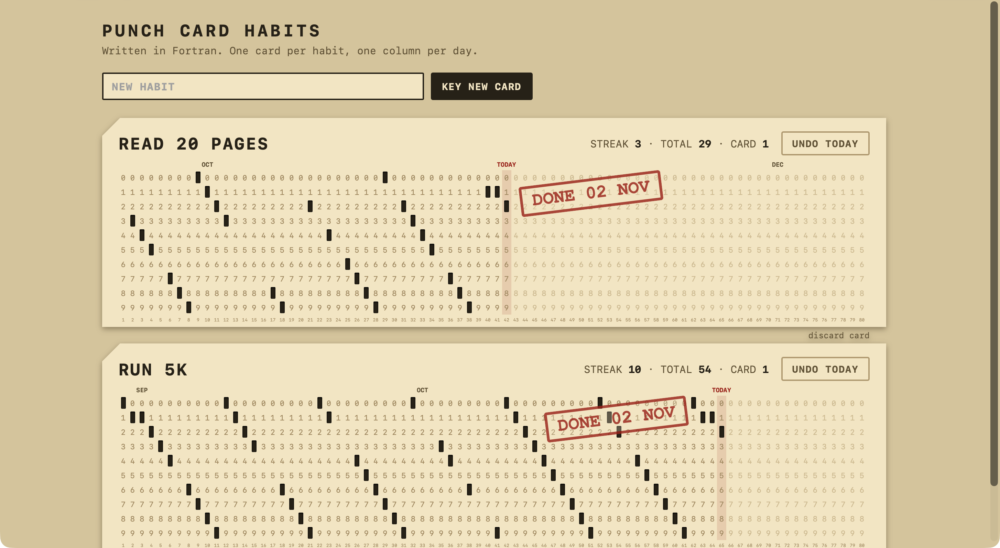

# Punch Card Habits

A habit tracker written in Fortran, including the web server. Every habit is a punch card
with 80 columns, one per day. Doing the habit punches a hole in today's column and thumps a
red stamp onto the card. There's no JavaScript: every click is a plain form post.



## Run it

```bash
brew install gcc
./build.sh
./habits
```

Then open http://localhost:8080. Run it from this folder: it keeps its data in `data/`.

## How it works

| Part | Fortran |
|---|---|
| The card | One column per day, and the hole goes in the row matching the date's last digit (`mod(d, 10)`). That rule is my own invention. A streak becomes a staircase, and a skipped day leaves a gap. A new card starts every 80 days. |
| Networking | `socket`, `bind`, `listen`, `accept` from libc, declared with `iso_c_binding` interfaces. |
| Concurrency | `fork`: one process per connection, so idle browser connections can't block the server. |
| Database | Two text files with fixed-width lines. Saving writes a temporary file, then renames it over the old one. |
| Queries | Array expressions: `any(p%habit_id == id .and. p%day == day)`, and `pack` to remove a punch. |
| Forms | URL decoding by hand, and habit names forced to capitals like a real keypunch. |
| Stamp | CSS only: after a punch, the redirect URL names the card and day that get the animation. |
| Safety | Names are HTML-escaped, and posts from another website's origin are refused. |

## Limitations

This is a fun experiment, not production software.

- **macOS only:** the `sockaddr_in` layout and socket option numbers are macOS values.
- **Localhost only:** it listens on 127.0.0.1:8080. There's no TLS and no auth.
- **Current card only:** finished cards can't be viewed, though the total counts every punch.
- **Limits:** 12 habits, 40 characters per name, 8 KB per request.
- **Whole-file writes:** two requests changing data at the same moment can overwrite each other.

## License

MIT
